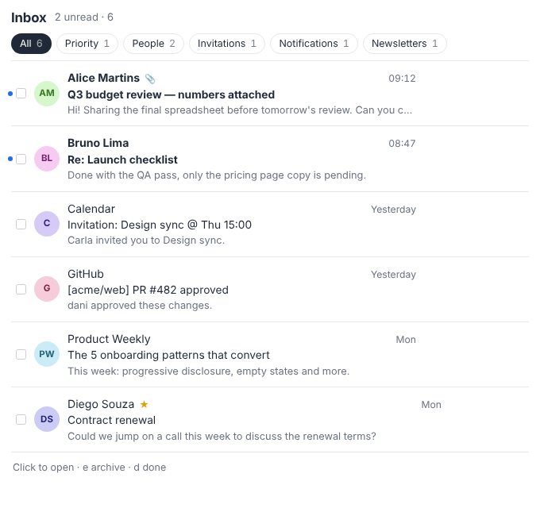
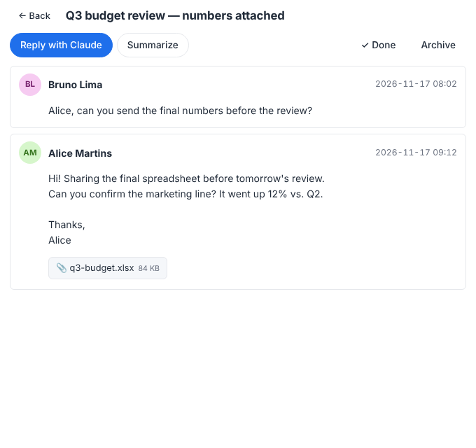
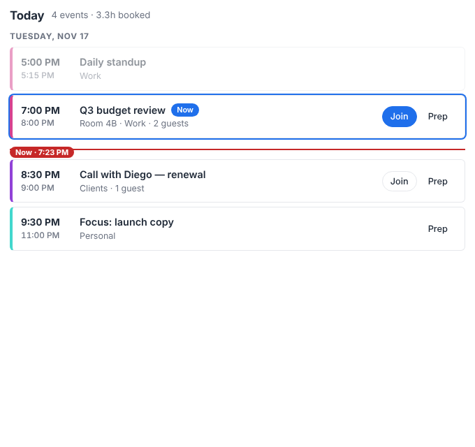
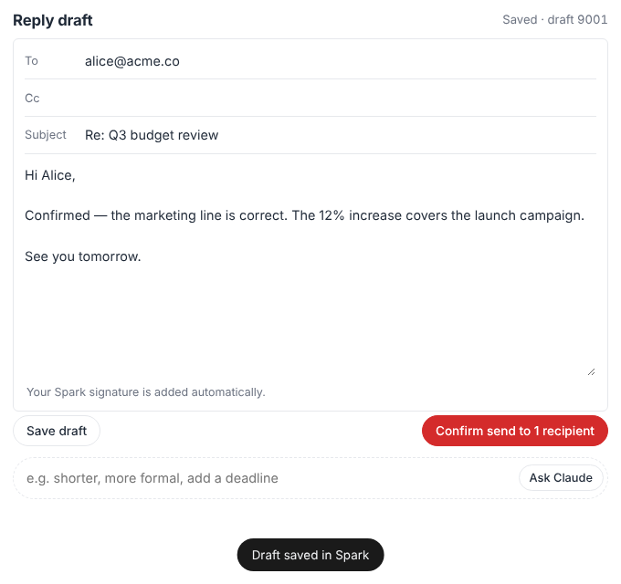

# spark-ui

MCP Apps layer for the Spark plugin. It serves one bundled view (`ui://spark/app.html`) and proxies every read and action to the Spark CLI's own MCP server (`spark mcp`).

| Tool | Visible to | Purpose |
|------|-----------|---------|
| `show_inbox`, `show_thread`, `show_agenda`, `review_draft` | model + app | Render a view (with text fallback) |
| `ui_thread`, `ui_action`, `ui_draft_save`, `ui_draft_send` | app only | What the view calls on user clicks |

`ui_action` only accepts triage verbs (archive, done, pin, snooze, ...). Sending is a separate tool that the view calls only after a two-step confirm.

## Develop

```bash
npm install
npm run build              # type-check, bundle the view, bundle the server into dist/
npm test                   # protocol tests: mock mode + proxying to a fake `spark mcp`
SPARK_UI_MOCK=1 node dist/index.js   # run with canned data
node scripts/preview.mjs preview dark  # screenshots of every view (needs Playwright)
```

`dist/` is committed so the plugin runs without a build step.

| Env var | Default | Effect |
|---------|---------|--------|
| `SPARK_CLI` | `spark` | Spark CLI binary to spawn as `<bin> mcp` |
| `SPARK_UI_MOCK` | unset | `1` = canned data, never touches Spark |

## Screenshots (mock data)

| Inbox | Thread |
|---|---|
|  |  |
| **Agenda** | **Draft review** |
|  |  |
